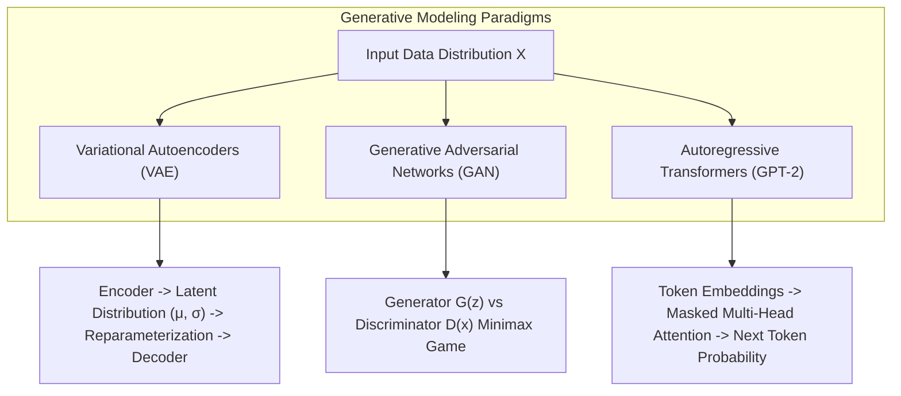

# 🎨 Generative AI Laboratory & Research Index

<p align="center">
  
</p>

<p align="center">
  A rigorous academic laboratory and experimental research repository implementing 11 major Generative AI paradigms across Deep Convolutional GANs (DCGANs), Variational Autoencoders (VAEs), StyleGAN2 latent manifolds, Neural Style Transfer, and causal GPT-2 fine-tuning.
</p>

<p align="center">
  <a href="https://github.com/prakruthidevanga/Generative-AI">
    
  </a>
</p>

<p align="center">
  
  
  
  
</p>

---

## 📌 Table of Contents

- [📖 Project Overview](#-project-overview)
- [🎯 Objectives](#-objectives)
- [🔬 11 Experimental Assignments](#-11-experimental-assignments)
- [🏗️ Generative Modeling Architectures](#️-generative-modeling-architectures)
- [🛠️ Technology Stack](#️-technology-stack)
- [📁 Repository Structure](#-repository-structure)
- [⚙️ Installation and Setup](#️-installation-and-setup)
- [🔮 Future Enhancements](#-future-enhancements)
- [🤝 Contributing](#-contributing)
- [👩‍💻 Author & Accreditations](#-author--accreditations)

---

## 📖 Project Overview

Generative Artificial Intelligence is transforming computational creativity, computer vision, and language synthesis. Understanding these systems requires a rigorous grasp of probability distribution mapping, adversarial minimax games, latent manifold geometry, and transformer self-attention mechanisms.

This repository captures comprehensive implementations and empirical evaluations across **11 major laboratory assignments** completed as part of the specialized Artificial Intelligence & Machine Learning curriculum at Alliance University.

🎨 **Core Mission:** Provide reproducible implementations of fundamental generative architectures from mathematical formulations to trained neural outputs.

---

## 🎯 Objectives

- 🎲 **Contrast Generative vs. Discriminative Models:** Compare joint distribution $P(X, Y)$ versus conditional probability $P(Y|X)$ on benchmark datasets.
- ⚔️ **Master Adversarial Optimization:** Train Deep Convolutional GANs (DCGAN) on Fashion-MNIST, investigating minimax loss and techniques to prevent mode collapse.
- 📐 **Explore Latent Manifolds:** Construct Variational Autoencoders (VAEs) using the reparameterization trick ($z = \mu + \sigma \odot \epsilon$) and explore continuous latent spaces.
- 🖼️ **Apply Neural Style Transfer:** Separate and recombine image content and style using deep convolutional representations from VGG19.
- 📝 **Fine-Tune Language Models:** Adapt pretrained autoregressive transformers (GPT-2) for specialized styling and evaluate generation bias.

---

## 🔬 11 Experimental Assignments

| Assignment # | Notebook Name | Core Generative Paradigm | Framework & Dataset |
| :-: | :--- | :--- | :--- |
| **01** | `Assignment_1_Understanding_Generative_and_Discriminative_Models` | Generative vs Discriminative Comparison | PyTorch / MNIST |
| **02** | `Assignment_2_Exploring_Text_Generation_Using_GPT_2` | Autoregressive Decoding (Top-k, Top-p, Temperature) | Transformers / GPT-2 |
| **03** | `ASSIGNMENT_3_Identifying_Bias_in_a_Pretrained_Generative_AI_Model` | Model Auditing, Toxicity & Responsible AI | Hugging Face / GPT-2 |
| **04** | `Assignment_4_Training_a_DCGAN_on_Fashion_MNIST_Dataset` | Deep Convolutional Adversarial Synthesis | PyTorch / Fashion-MNIST |
| **05** | `Assignment_5_Exploring_the_Latent_Space_of_StyleGAN2` | Latent Vector Inversion & Manifold Geometry | StyleGAN2 / AFHQ |
| **06** | `Assignment_6_Applying_AI_Based_Style_Transfer_to_an_Image` | Neural Style Transfer (Gram Matrix Optimization) | VGG19 / Gatys et al. |
| **07** | `Assignment_7_Creating_and_Fixing_Mode_Collapse_in_a_GAN` | Adversarial Instability & Wasserstein Regularization | WGAN-GP / Minimax |
| **08** | `ASSIGNMENT_8_Building_a_Variational_Autoencoder` | Latent Space Visualization & Reconstruction | VAE / KL Divergence |
| **09** | `Assignment_9_Using_VAE_for_Compression_and_Denoising` | Manifold Image Denoising & Latent Compression | Convolutional VAE |
| **10** | `ASSIGNMENT_10_Comparing_GAN_and_VAE_Experimental_Results` | Empirical Trade-offs: FID Score vs Reconstruction Loss | GAN vs VAE |
| **11** | `Assignment_11_Fine_Tuning_GPT2_Custom_Style` | Domain-Specific Causal LM Fine-Tuning | Hugging Face Trainer |

---

## 🏗️ Generative Modeling Architectures



---

## 🛠️ Technology Stack

<p align="center">
  
</p>

| Category | Tools & Libraries |
| :--- | :--- |
| **Core Frameworks** | PyTorch, TensorFlow / Keras, Hugging Face `transformers` |
| **Model Architectures** | GPT-2, DCGAN, VAE, StyleGAN2, VGG19 (Style Transfer) |
| **Image & Data Processing** | Torchvision, Pillow (PIL), NumPy, Scikit-learn |
| **Visualization & Telemetry** | Matplotlib, Seaborn, Jupyter Notebook |

---

## 📁 Repository Structure

```text
Generative-AI/
├── ASSIGNMENT_10_Comparing_GAN_and_VAE_Experimental_Results.ipynb
├── Assignment_11_Fine_Tuning_GPT2_Custom_Style.ipynb
├── Assignment_1_Understanding_Generative_and_Discriminative_Models.ipynb
├── Assignment_2_Exploring_Text_Generation_Using_GPT_2.ipynb
├── ASSIGNMENT_3_Identifying_Bias_in_a_Pretrained_Generative_AI_Model.ipynb
├── Assignment_4_Training_a_DCGAN_on_Fashion_MNIST_Dataset.ipynb
├── Assignment_5_Exploring_the_Latent_Space_of_StyleGAN2.ipynb
├── Assignment_6_Applying_AI_Based_Style_Transfer_to_an_Image.ipynb
├── Assignment_7_Creating_and_Fixing_Mode_Collapse_in_a_GAN.ipynb
├── ASSIGNMENT_8_Building_a_Variational_Autoencoder.ipynb
├── Assignment_9_Using_VAE_for_Compression_and_Denoising.ipynb
└── README.md
```

---

## ⚙️ Installation and Setup

### Prerequisites
- Python 3.9+
- GPU acceleration (CUDA) recommended for training GANs and fine-tuning GPT-2

### Running the Notebooks:
```bash
git clone https://github.com/prakruthidevanga/Generative-AI.git
cd Generative-AI
python -m venv .venv
.\.venv\Scripts\Activate.ps1
pip install torch torchvision transformers datasets scikit-learn matplotlib jupyter
jupyter notebook
```

---

## 🔮 Future Enhancements

- 🌊 **Diffusion Models:** Add modern DDPM (Denoising Diffusion Probabilistic Models) notebooks.
- 🎯 **LoRA & QLoRA:** Implement low-rank adaptation techniques for fine-tuning larger 7B+ LLMs.

---

## 🤝 Contributing

Contributions, feedback, and experiment variations are welcomed! Feel free to fork and open a PR.

---

## 👩‍💻 Author & Accreditations

**Prakruthi B R**  
*BCA Student specializing in Artificial Intelligence & Machine Learning*  
*Alliance University, Bengaluru (CGPA: 9.60)*  
*GeeksforGeeks Campus Mantri (2026)*

- 💻 **GitHub:** [@prakruthidevanga](https://github.com/prakruthidevanga)
- 🔗 **LinkedIn:** [Prakruthi BR](https://linkedin.com/in/prakruthi-br)
- 🌐 **Portfolio:** [prakruthidevanga.github.io](https://prakruthidevanga.github.io/)
- 📬 **Email:** [prakruthibr2006@gmail.com](mailto:prakruthibr2006@gmail.com)

---

<p align="center">
  <b>🎨 Exploring the frontier of generative modeling and computational creativity.</b>
</p>

<p align="center">
  
</p>
