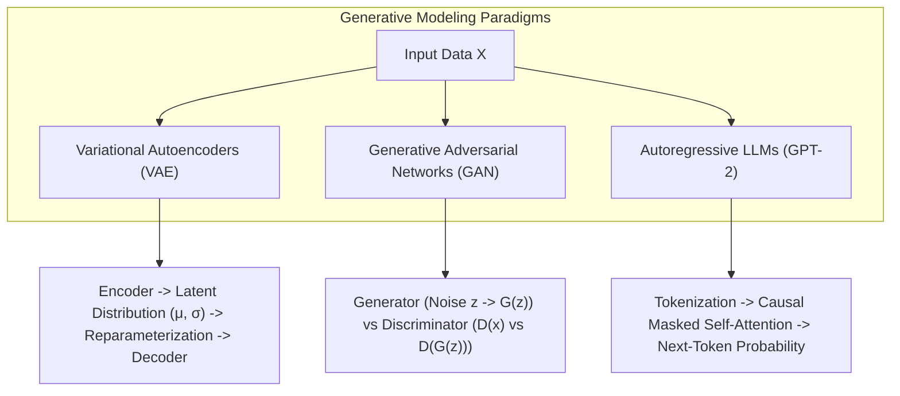

# 🤖 Generative AI Laboratory & Research Assignments

A comprehensive academic and experimental laboratory repository showcasing Generative AI, Deep Generative Modeling, Neural Style Transfer, Variational Autoencoders (VAEs), Generative Adversarial Networks (GANs), and Large Language Model (LLM) fine-tuning completed during undergraduate studies at Alliance University.

---

## 📌 Repository Overview

This repository documents the theoretical foundations, implementation architectures, and empirical evaluations across 11 major Generative AI paradigms:
- **Generative vs. Discriminative Modeling:** Mathematical and experimental comparisons on the MNIST dataset.
- **Large Language Models (LLMs):** Text generation, sampling strategies (temperature, top-k, top-p), bias evaluation, and custom style fine-tuning with GPT-2.
- **Deep Convolutional GANs (DCGANs):** Adversarial minimax training, generator/discriminator optimization on Fashion-MNIST, and mitigating mode collapse via Wasserstein loss and feature matching.
- **Variational Autoencoders (VAEs):** Encoder-decoder latent space mapping, reparameterization trick, image denoising, and continuous interpolation.
- **Neural Style Transfer:** VGG19 feature extraction, Gram matrix style representation, and Gatys et al. style reconstruction.
- **High-Resolution Synthesis & Latent Manipulation:** Exploring latent space vectors and disentanglement in StyleGAN2.

---

## 🔬 Experimental Assignments & Notebook Index

| # | Notebook | Core Topic | Architecture / Framework |
| :-: | :--- | :--- | :--- |
| **01** | `Assignment_1_Understanding_Generative_and_Discriminative_Models` | Generative vs Discriminative | PyTorch / TensorFlow, MNIST |
| **02** | `Assignment_2_Exploring_Text_Generation_Using_GPT_2` | Autoregressive Generation & Decoding | Hugging Face Transformers, GPT-2 |
| **03** | `ASSIGNMENT_3_Identifying_Bias_in_a_Pretrained_Generative_AI_Model` | Responsible AI & Bias Auditing | GPT-2, Sentiment & Toxicity Metrics |
| **04** | `Assignment_4_Training_a_DCGAN_on_Fashion_MNIST_Dataset` | Deep Convolutional GANs | PyTorch / TensorFlow, Fashion-MNIST |
| **05** | `Assignment_5_Exploring_the_Latent_Space_of_StyleGAN2` | Latent Space Disentanglement | StyleGAN2, W/W+ Latent Projections |
| **06** | `Assignment_6_Applying_AI_Based_Style_Transfer_to_an_Image` | Neural Style Transfer | VGG19, Gram Matrix Optimization |
| **07** | `Assignment_7_Creating_and_Fixing_Mode_Collapse_in_a_GAN` | Adversarial Stability & Regularization | Minimax vs WGAN-GP, Feature Matching |
| **08** | `ASSIGNMENT_8_Building_a_Variational_Autoencoder` | Latent Space Visualization & Manifolds | VAE, Reparameterization Trick, KL Divergence |
| **09** | `Assignment_9_Using_VAE_for_Compression_and_Denoising` | Latent Compression & Image Denoising | Convolutional VAE, Mean Squared Error |
| **10** | `ASSIGNMENT_10_Comparing_GAN_and_VAE_Experimental_Results` | Empirical Comparison (GAN vs VAE) | FID / Reconstruction Loss Trade-offs |
| **11** | `Assignment_11_Fine_Tuning_GPT2_Custom_Style` | Domain-Specific LLM Fine-Tuning | Hugging Face Trainer, Casual LM |

---

## 🏗️ Architectural Foundations



---

## ⚙️ Installation & Usage

### Prerequisites
- Python 3.9+
- GPU recommended (Google Colab / CUDA support) for training DCGANs, StyleGAN2, and fine-tuning GPT-2.

### Environment Setup:

1. **Clone the repository:**
   ```bash
   git clone https://github.com/prakruthidevanga/Generative-AI.git
   cd Generative-AI
   ```

2. **Install required deep learning and generative modeling libraries:**
   ```bash
   pip install torch torchvision transformers datasets scikit-learn matplotlib seaborn jupyter
   ```

3. **Launch Jupyter:**
   ```bash
   jupyter notebook
   ```

---

## 🛠️ Technology Stack

- **Core Frameworks:** PyTorch, TensorFlow / Keras, Hugging Face `transformers`
- **Generative Models:** GPT-2, DCGAN, VAE, StyleGAN2, VGG19 (Style Transfer)
- **Data & Evaluation:** Torchvision, NumPy, Matplotlib, Seaborn
- **Environment:** Jupyter Notebook, Google Colab

---

## 👩‍💻 Author & Contributions

- **Author:** Prakruthi B R ([@prakruthidevanga](https://github.com/prakruthidevanga))
- **Program:** BCA (Specialization in Artificial Intelligence and Machine Learning), Alliance University.
- **Contributions:** Implemented, trained, and documented all 11 experimental notebooks covering adversarial training, latent manifold interpolation, and transformer fine-tuning.
